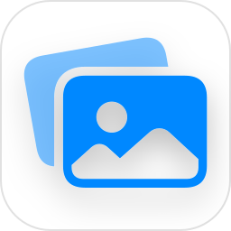
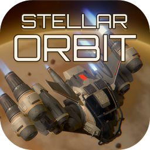

### Hi, I'm Juha

I make software in Finland. Here's what I'm working on:

<table>
  <tr>
    <td width="112"></td>
    <td><b><a href="https://github.com/YlitaloJuha/lanka">Lanka</a></b> Live, visual specs for software teams. Self-hosted canvases beside Git, with states, what changed and AI agents. Open source, Apache-2.0.</td>
  </tr>
  <tr>
    <td width="112"></td>
    <td><b><a href="https://github.com/YlitaloJuha/pickr">Pickr.</a></b> Clear burst shots and near-duplicates from your iPhone camera roll. 100% on-device. App Store: coming soon.</td>
  </tr>
  <tr>
    <td width="112"></td>
    <td><b>Stellar Orbit</b> A top-down mining-survival game for PC, made in Godot.</td>
  </tr>
</table>

<!-- Optional: how to reach you (LinkedIn, email, site). -->
